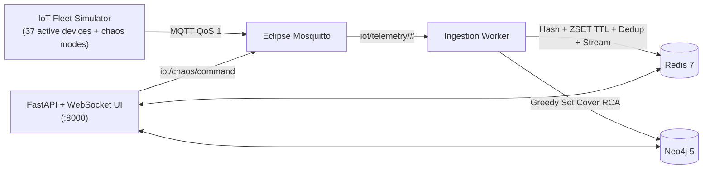

# IoT Topology RCA — Fault Correlation with Redis & Neo4j

A production-style **IoT observability and Root Cause Analysis (RCA)** platform that combines **Redis** (low-latency heartbeat tracking) and **Neo4j** (infrastructure dependency graph) to eliminate alert storms and pinpoint root causes in real time.

Instead of firing 20+ redundant alerts when a gateway, switch, or passive power panel fails, the engine correlates live offline states with the physical/network topology and collapses the cascade into **one actionable root-cause incident**.

---

## Why NoSQL? (Polyglot Data Modeling Rationale)

| Concern | Database | Why this NoSQL engine fits |
| :--- | :--- | :--- |
| **Live Heartbeats & Expiration** | **Redis** | Sub-millisecond writes, `Hash` per device state, `Sorted Set (ZSET)` + atomic Lua sweep for reliable TTL expiration, `SET NX EX` for MQTT QoS-1 deduplication, and `Redis Streams` for ordered state transitions. |
| **Dependency Topology & RCA** | **Neo4j** | Multi-hop graph traversals (`PowerPanel <-[:POWERED_BY]- NetworkSwitch <-[:UPLINK_VIA]- Gateway <-[:CONNECTED_TO]- Sensor`) without recursive SQL `JOIN`s, plus persisted `:Incident` lineage (`[:ROOT_CAUSE]`, `[:IMPACTS]`). |

---

## Architecture



### How Heartbeat Expiration Works Without Missing Events
Instead of relying solely on Redis Keyspace Notifications (which are fire-and-forget and can be missed during worker restarts), `RedisStateStore` maintains:
1. `iot:heartbeats:expiry` (**Sorted Set**): `score = now + ttl_seconds`, `member = device_id`.
2. An **atomic Lua script** (`ZRANGEBYSCORE` + `ZREMRANGEBYSCORE`) pops overdue devices safely without racing against newly arrived heartbeats.
3. Transition events (`ONLINE` / `OFFLINE`) are appended to the `iot:stream:state_changes` **Redis Stream** and pushed over Pub/Sub to update the WebSocket dashboard.

### How Graph RCA Works (Even for Passive Hardware!)
In industrial environments, a **Power Panel** does not send MQTT heartbeats. Yet when `pp-main-a` trips, `sw-core-01`, `gw-lora-01`, `gw-modbus-01`, `gw-lte-01`, and 18 sensors go dark simultaneously.

The engine (`src/iot_rca/rca_engine.py`) evaluates candidate ancestors fetched from Neo4j using **Greedy Set Cover**:
- **Sensors** are blamed only when isolated.
- **Active infrastructure** (`Gateway`, `NetworkSwitch`) is blamed only when it is itself offline in Redis and `>= 75%` of its downstream sensors are offline (tolerating TTL jitter).
- **Passive infrastructure** (`PowerPanel`) is blamed only when `0` child switches/gateways are online and `>= 85%` of downstream sensors are offline.
- Incidents automatically **escalate** or **resolve** as downstream devices expire or recover.

---

## Quick Start

```bash
git clone https://github.com/Robertkevyngg/iot-topology-rca.git
cd iot-topology-rca
cp .env.example .env

# Option A: Docker Compose v2
docker compose up --build

# Option B: Plain Docker CLI helper (if docker-compose plugin is not installed)
./scripts/stack.sh up
```

Open:
- **Live Topology Dashboard:** http://localhost:8000
- **Interactive API Docs (Swagger):** http://localhost:8000/docs
- **Neo4j Browser:** http://localhost:7474

Use the **Chaos Fault Injection** buttons at the top of the dashboard (or `POST /api/v1/chaos`) to test:
1. `healthy` — All 37 active devices online.
2. `single_sensor` — Isolates `sns-temp-01` (0% suppression, sensor-level fault).
3. `gateway_failure` — Kills `gw-lora-01` and its 8 sensors -> **1 incident, 8 alerts suppressed (88.9% noise reduction)**.
4. `switch_failure` — Kills `sw-core-01` (14 sensors across 2 gateways, while LTE gateway `gw-lte-01` remains online to distinguish switch from power panel!).
5. `power_panel_failure` — Kills passive `pp-main-a` (22 active nodes offline) -> **1 incident, 21 alerts suppressed (95.5% noise reduction)**.

---

## Key API Endpoints

| Method | Path | Description |
| :--- | :--- | :--- |
| `GET` | `/health` | Readiness check for Redis and Neo4j |
| `GET` | `/api/v1/topology` | Live graph snapshot joined with Redis states and open incidents |
| `GET` | `/api/v1/blast-radius/{node_id}` | Downstream impact analysis from Neo4j (`PowerPanel`, `NetworkSwitch`, `Gateway`, `Zone`) |
| `GET` | `/api/v1/incidents` | List `OPEN` or `RESOLVED` incidents stored in Neo4j |
| `POST` | `/api/v1/chaos` | Dispatch a chaos scenario (`healthy`, `single_sensor`, `gateway_failure`, `switch_failure`, `power_panel_failure`) |
| `GET` | `/api/v1/events/stream` | Latest `ONLINE`/`OFFLINE` transitions from Redis Stream |
| `WS` | `/ws/live` | Real-time topology and incident updates |

---

## Running Tests & Linting

```bash
# Unit tests (pure RCA correlation, models, parser, chaos simulator, API mocks)
pytest tests/unit -v --cov=src/iot_rca --cov-report=term-missing

# Full E2E integration tests against live Redis and Neo4j
RUN_INTEGRATION_TESTS=1 NEO4J_PASSWORD=iot_topo_local_dev pytest tests/integration -v

# Linter
ruff check src tests
```

---

## Project Structure

```text
iot-topology-rca/
├── docker-compose.yml
├── Dockerfile
├── topology/seed_topology.json
├── mosquitto/mosquitto.conf
├── src/iot_rca/
│   ├── config.py          # Environment-validated Pydantic Settings
│   ├── models.py          # Immutable domain models
│   ├── redis_store.py     # Hashes, ZSET expiry + Lua sweep, dedup, Streams, Pub/Sub
│   ├── neo4j_repo.py      # Cypher topology seeding, RCA candidates, Blast Radius, Incidents
│   ├── rca_engine.py      # Deterministic Greedy Set Cover RCA algorithm
│   ├── mqtt_ingester.py   # MQTT subscriber + expiry sweeper + RCA orchestrator
│   ├── simulator.py       # 37-device MQTT fleet simulator + chaos controller
│   ├── api.py             # FastAPI REST + WebSocket + live topology UI
│   └── static/            # Interactive SVG topology & blast-radius dashboard
└── tests/
    ├── unit/
    └── integration/
```
